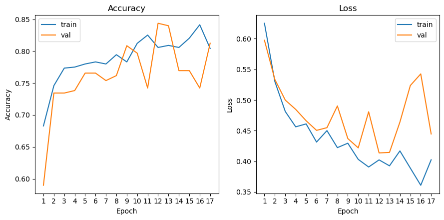

# 🏸 Rally Detector

**Detecting rally segments in badminton videos with a ResNet18 + LSTM model.**

Given a 30-frame clip from a match video, the model classifies whether it is **rally** or **non-rally**.
Since a point is scored exactly when a rally ends, detecting rally boundaries is the first step toward an **automatic, real-time scoreboard** — counting points without manual input.

> Individual project · Artificial Intelligence course (Fall 2025, Sejong University)

| Accuracy | F1 Score | Precision | Recall |
|:---:|:---:|:---:|:---:|
| **86.2%** | **0.810** | 0.829 | 0.791 |

<sub>Test set: 116 sequences from 1 unseen video</sub>

**What I did**
- Built the dataset from scratch: YouTube download → frame extraction → 30-frame sequencing → manual labeling tool (`labeling.py`)
- Designed a CNN + LSTM hybrid for temporal classification and tuned hyperparameters
- Analyzed class imbalance and train/val/test distribution mismatch

**Tech Stack**: Python, PyTorch, torchvision (ResNet18), OpenCV, pytubefix

---

## 🧠 Model: ResNet + LSTM Hybrid

This model consists of two major parts:

### 1. CNN Feature Extractor (ResNet18)

- Pretrained on ImageNet
- Outputs a **512-dimensional feature** for each frame
- Frozen backbone to prevent overfitting and reduce compute

### 2. LSTM Temporal Model

- 2-layer LSTM
- Hidden size = 128
- Mean pooling across the 30-frame sequence
- Fully connected head for binary classification

<details>
<summary>RES_LSTM Model Summary (torchinfo) — Input Size (1, 30, 3, 224, 224)</summary>

| Layer Type         | Name / (Depth-Idx)          | Output Shape       | Param #    |
|-------------------|-----------------------------|--------------------|------------|
| **Model**         | RES_LSTM                    | [1, 1]             | --         |
| **CNN Backbone (ResNet18, frozen)** ||||
| Conv2d            | 2-1                         | [30, 64, 112,112]  | 9,408      |
| BatchNorm2d       | 2-2                         | [30, 64,112,112]   | 128        |
| ReLU              | 2-3                         | [30, 64,112,112]   | 0          |
| MaxPool2d         | 2-4                         | [30, 64,56,56]     | 0          |
| BasicBlock        | 3-1                         | [30, 64,56,56]     | 73,984     |
| BasicBlock        | 3-2                         | [30, 64,56,56]     | 73,984     |
| BasicBlock        | 3-3                         | [30,128,28,28]     | 230,144    |
| BasicBlock        | 3-4                         | [30,128,28,28]     | 295,424    |
| BasicBlock        | 3-5                         | [30,256,14,14]     | 919,040    |
| BasicBlock        | 3-6                         | [30,256,14,14]     | 1,180,672  |
| BasicBlock        | 3-7                         | [30,512, 7, 7]     | 3,673,088  |
| BasicBlock        | 3-8                         | [30,512, 7, 7]     | 4,720,640  |
| AdaptiveAvgPool2d | 2-9                         | [30,512,1,1]       | 0          |
| **LSTM**          | 1-2                         | [1, 30,128]        | 460,800    |
| **FC Head**       | 1-3                         | [1,1]              | --         |
| Linear            | 2-10                        | [1,64]             | 8,256      |
| ReLU              | 2-11                        | [1,64]             | 0          |
| Dropout           | 2-12                        | [1,64]             | 0          |
| Linear            | 2-13                        | [1,1]              | 65         |

</details>

---

## 📦 Dataset

The dataset consists of badminton rally sequences extracted from YouTube videos.
Each sequence contains **30 consecutive frames**, resized to **224×224** (ImageNet standard).

| Split | Sequences | Videos | Non-rally (0) | Rally (1) |
|---|---:|---:|---:|---:|
| Train | 618 | 5 | 425 (68.8%) | 193 (31.2%) |
| Validation | 256 | 2 | 151 (59.0%) | 105 (41.0%) |
| Test | 116 | 1 | 73 (62.9%) | 43 (37.1%) |

### Data Preprocessing — `collecting_data.py`

1. Download YouTube videos using **pytubefix**
2. Extract frames every *interval seconds*
3. Resize to **224×224**
4. Group into sequences of **30 frames**
5. Manually label using `labeling.py` (0 = non-rally, 1 = rally)

<details>
<summary>Directory structure</summary>

```
Data
├── train
│   ├── sequences
│   │   ├── seq_00001
│   │   │   ├── 00001.jpg
│   │   │   ├── 00002.jpg
│   │   │   └── ...
│   │   └── ...
│   └── train.csv
├── validation
│   ├── sequences/...
│   └── validation.csv
└── test
    ├── sequences/...
    └── test.csv
```

</details>

---

## 🏋️ Training

### Settings

- **Loss**: BCEWithLogitsLoss
- **Optimizer**: Adam (lr = 1e-4)
- **Batch size**: 4
- **Epochs**: 20
- **Early stopping**

### Optimized Hyperparameters

After trying various hyperparameters, this one performed the best.

| Batch size | Learning rate | LSTM hidden size | LSTM layers | Dropout |
|:---:|:---:|:---:|:---:|:---:|
| 4 | 1e-4 | 128 | 2 | 0.3 |

Only this configuration triggered early stopping (i.e., converged stably).

### Data Augmentation — not used

Random horizontal flip, random rotation and color jitter were tested, but they **lowered** performance, so the final model is trained without augmentation.

### Result

The average time per iteration is around 2.5 sec.

```
Epoch 01 | Train Loss: 0.625, Acc: 68.28% | Val Loss: 0.597, Acc: 58.98%
...
Epoch 17 | Train Loss: 0.403, Acc: 80.42% | Val Loss: 0.445, Acc: 81.25%
```



```
===== Test Metrics =====
Avg Loss: 0.3646
Accuracy:  0.8621
F1 Score:  0.8095
Precision: 0.8293
Recall:    0.7907
```

Validation loss stays higher than test loss. This is because the validation set does not have a similar class distribution to the test set, and the test set is small (116 sequences from a single video) — so test metrics should be read with that in mind.

---

## ⚠️ Limitations

### Limited Dataset Size

The total number of labeled sequences (618 training samples) is relatively small for a deep-learning model combining CNN and LSTM.
This can lead to unstable convergence, higher variance, and sensitivity to hyperparameter choices.

### Imbalanced / Mismatched Distribution

The validation set has a different class distribution compared to the test set (see the [Dataset](#-dataset) table).
This makes validation metrics less reliable for early stopping or hyperparameter tuning.

---

## 🚀 Future Improvements

- Collect a larger and more diverse dataset, including not only high-quality match broadcasts but also personal handheld or amateur videos, so the model can generalize to real-world usage.
- Reduce model computation to enable real-time inference, such as by using a lighter or partially-trainable CNN backbone (e.g., MobileNet, EfficientNet) or replacing the LSTM with a faster temporal model.
- Increase data variation (different cameras, resolutions, lighting, and environments) to make the system robust enough for everyday user-generated footage.
- Eventually extend the model to static, unedited match recordings so that it can detect rally segments automatically and count points in real time without manual intervention.

---

## ⚙️ Setup

1. Clone this repository.
2. Create a new folder `Data` and download the dataset: [Dataset (Google Drive)](https://drive.google.com/drive/folders/19a5XDU64GR2ml62koi11TIn2tR8SgR4_?usp=drive_link) *(it might take a while)*
3. Run `main.ipynb`.
